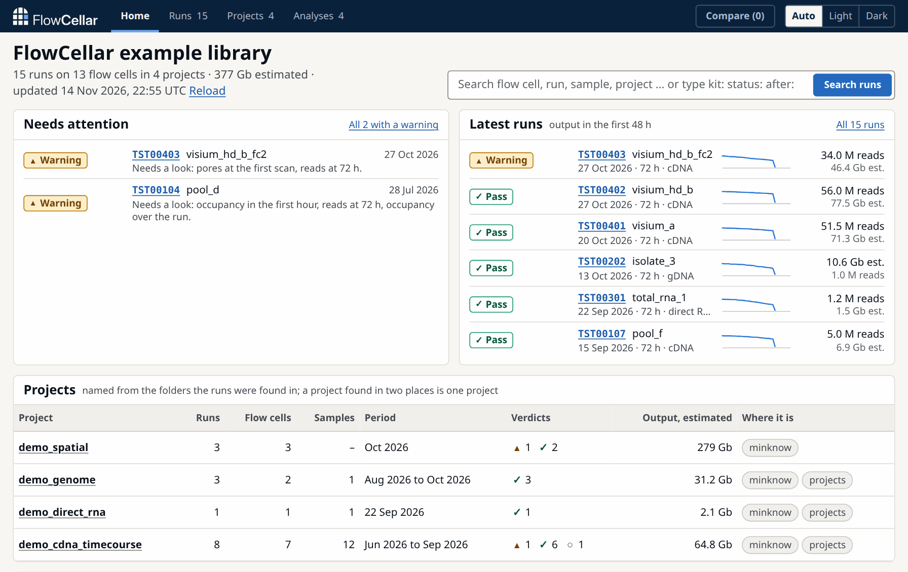
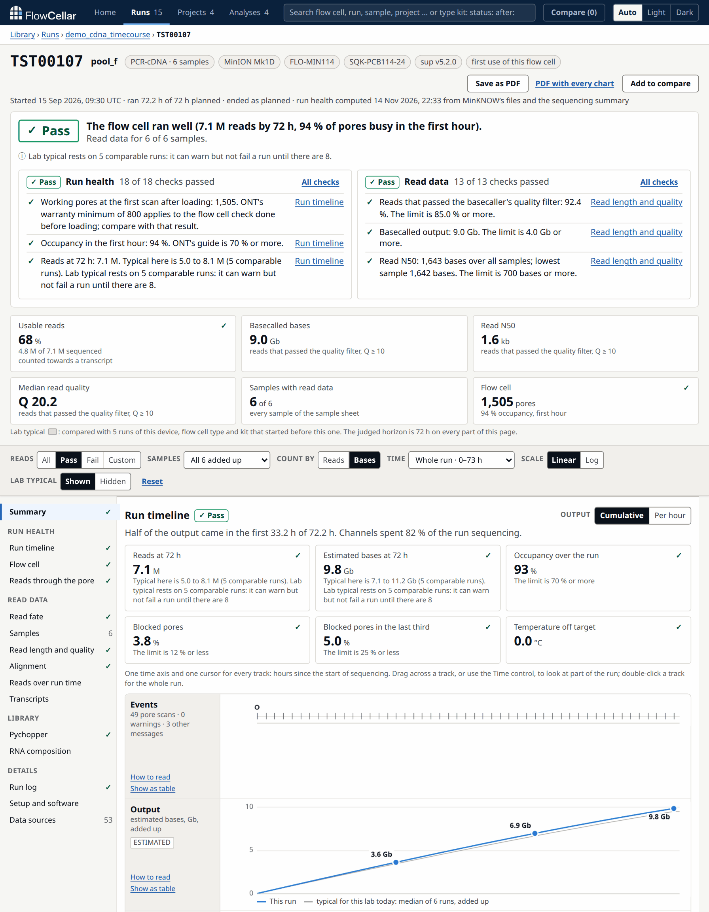
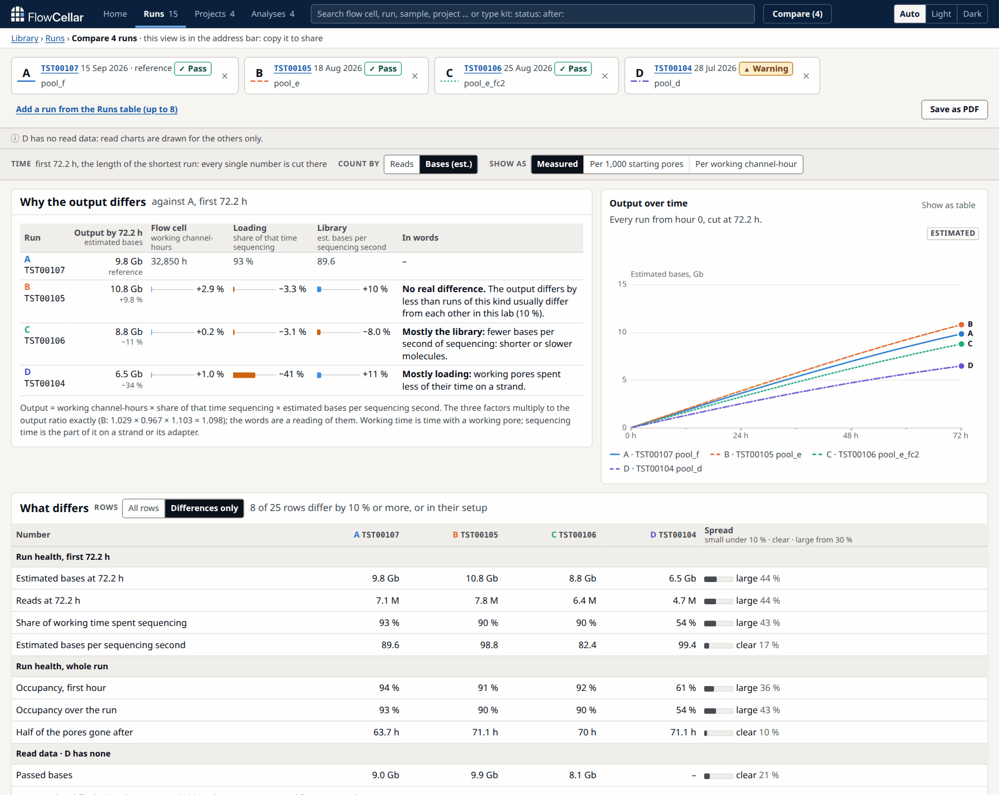
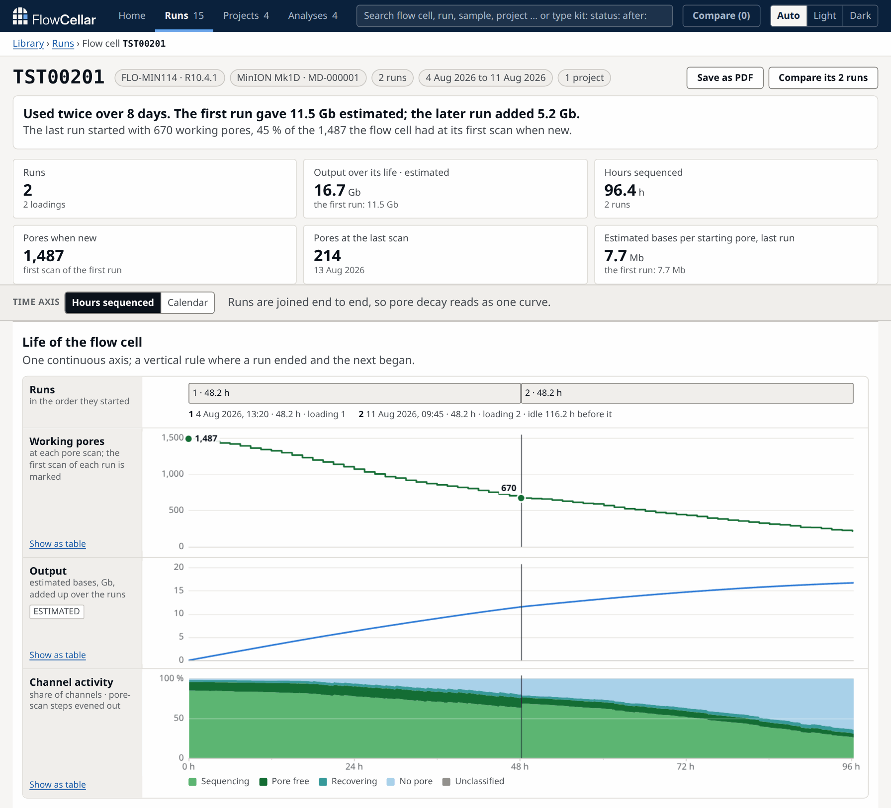
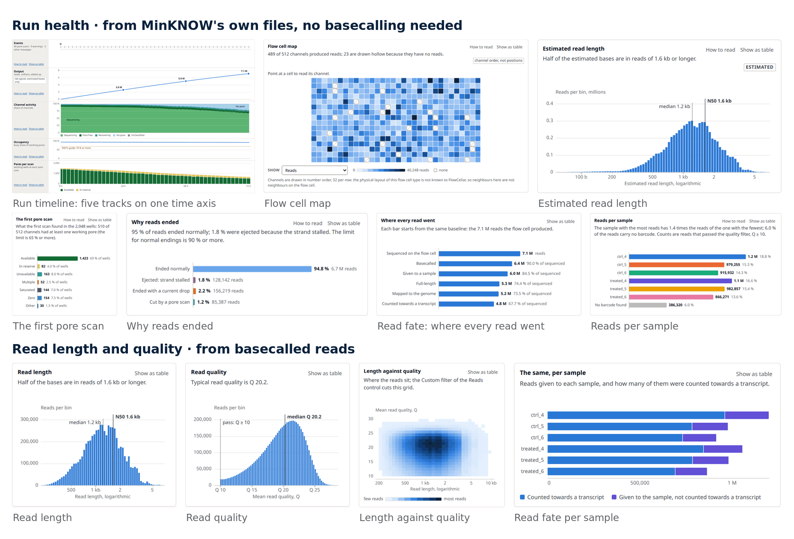
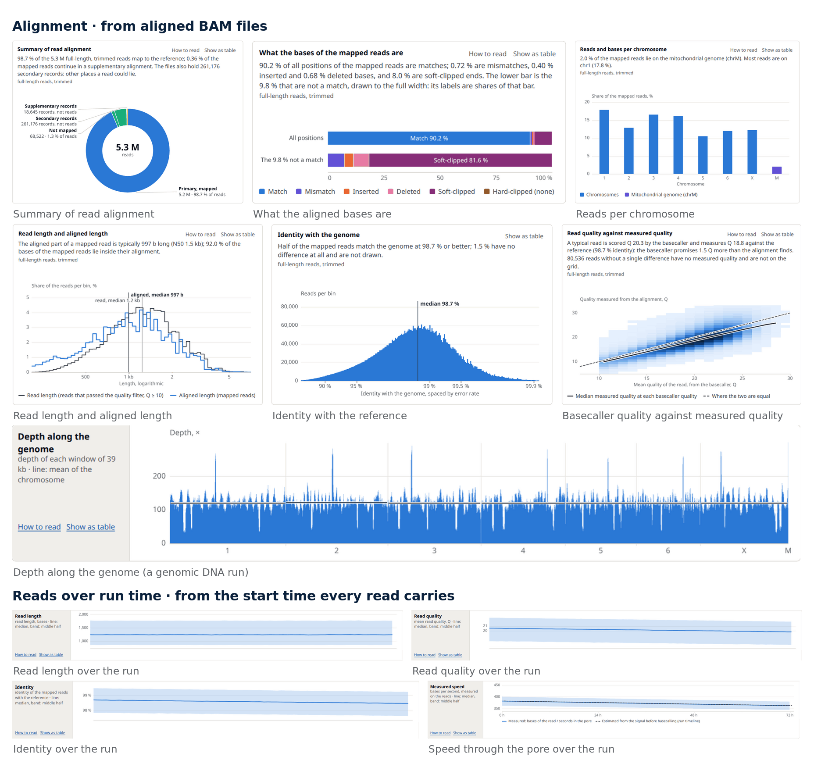
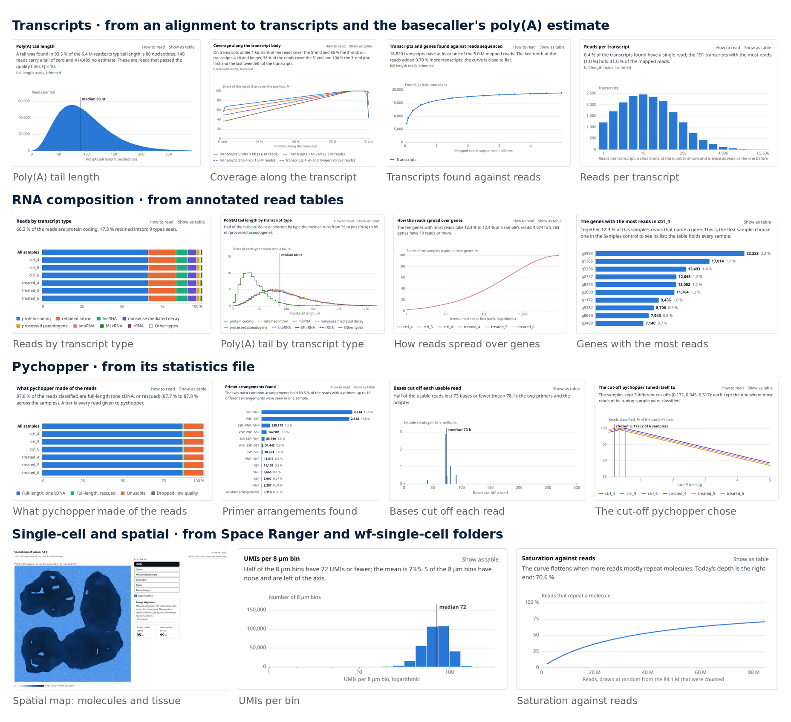
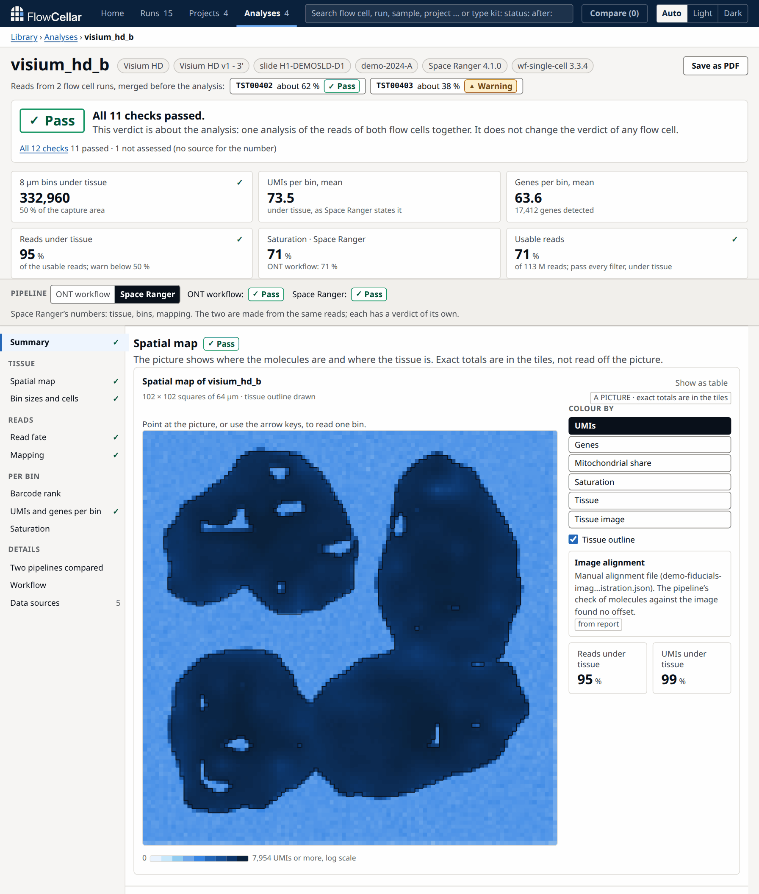
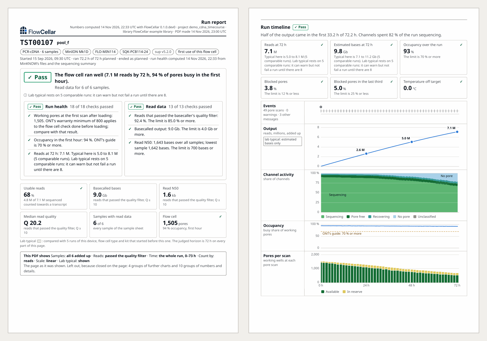
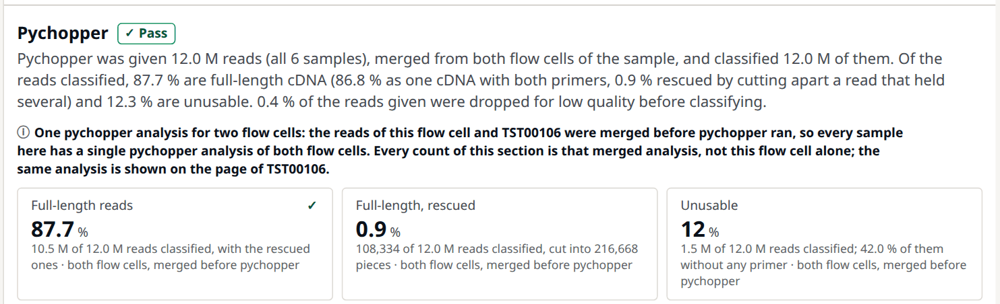

<p align="center">
  <picture>
    <source media="(prefers-color-scheme: dark)" srcset="viewer/brand/flowcellar-lockup-dark.svg">
    
  </picture>
</p>

FlowCellar is one quality control (QC) library for all your Oxford Nanopore flow cells: it finds every run
wherever its folder now lies, gives it a verdict with the reasons, and puts its basecalling, alignment and
analysis QC beside it, for you to search and compare in a browser.

<p align="center">
  
</p>

<p align="center"><sub>The Home page of the example library. Every picture on this page shows <a href="#try-it-without-your-own-data">invented example data</a>.</sub></p>

## The problem

A laboratory that sequences on nanopore flow cells soon has many runs: genomic DNA, cDNA, direct RNA, single-cell
and spatial libraries, in several projects. MinKNOW writes one report per run, into the folder of that run. What
happens after sequencing is what makes the runs hard to keep track of:

- **The run folders move.** They leave the sequencer's disk for a project share or an archive, and every project
  ends up with its flow cells in a place of its own.
- **Every pipeline adds QC of its own.** The reads are basecalled, aligned and analysed by one pipeline or another,
  and each leaves its numbers (basecalling QC, alignment statistics, pychopper statistics, a single-cell or spatial
  report) in another folder, far from the report of the run they belong to.
- **A project uses many flow cells.** A sample goes on two or three, a flow cell is washed and loaded again, and
  some months later nobody can say without searching which flow cells a project tried and how each of them did.
- **One report at a time compares nothing.** It does not say how this flow cell compares with the last twenty,
  which runs need a look, or what happened to a library preparation over the months of a project.

FlowCellar brings this together. It finds every run under the folders you name, wherever it was moved to, attaches
the basecalled, aligned and analysed reads to the flow cell they came from, and shows the QC of the run, of the
basecalled reads and of the analyses in one place: per flow cell, per project, and side by side.

## The idea

1. **Point `flowcellar scan` at the folders** your runs and analyses are in: the output folder of the sequencer, a
   project share, an archive.
2. **It recognises every run by its files and judges it**: Pass, Warning, Fail or Incomplete, with the reasons in
   plain sentences. For each run it keeps one small file in a **library**, a folder of its own.
3. **Open the library in a browser** and look at everything at once, at one run, or at several runs side by side.

```
flowcellar scan FOLDER… -L LIBRARY        # the folders to look under, and the library folder (made if not there)
flowcellar serve LIBRARY --open           # look at it
```

Nothing is copied from, moved in or written to the folders that are read, and no command contacts the network.

[Install](#install) · [Quick start](#quick-start) · [Try it without your own data](#try-it-without-your-own-data) ·
[What you look at](#what-you-look-at) · [What goes in](#what-goes-in) · [Works with what you have](#works-with-what-you-have)

<p align="center">
  <picture>
    <source media="(prefers-color-scheme: dark)" srcset="docs/img/overview-dark.svg">
    
  </picture>
</p>

## Install

Python 3.11 or newer, on Linux.

```
python3 -m venv flowcellar-env
. flowcellar-env/bin/activate
pip install "flowcellar[all]"
flowcellar doctor
```

`doctor` prints the versions and says whether the viewer is inside the package:

```
flowcellar 0.1.0 · bundle schema 0.1.1 · Python 3.12.5 · Linux x86_64
packages: numpy 2.5.4, pyarrow 26.0.1, click 8.5.1, pysam 0.24.1, jsonschema 4.26.0, h5py 3.16.0
  ok    viewer: the built viewer is in the package (4 files, hashes match)
(add -L DIR to check a library and its roots)
```

`all` adds pysam (reads BAM files), h5py (reads the HDF5 files of Space Ranger) and jsonschema (for
`flowcellar validate`). Without them FlowCellar still judges run health.

To work on FlowCellar itself, use a checkout as [docs/development.md](docs/development.md) describes.

## Quick start

The quick start uses example data that the package writes itself, so every command can be typed as it stands.
With your own runs, leave out step 1 and name your own folders in step 2.

**1. Write the example data.**

```
python -m flowcellar.testing.demo demo
```

Under a minute on eight cores, and 1.5 GB: an invented laboratory in the folder `demo`. `demo/minknow` is what a
sequencer writes, `demo/projects` what a pipeline leaves beside it, and `demo/library` holds a `flowcellar.toml` and
nothing else yet.

**2. Scan.** Give `scan` the folders to look under and the folder of the library, which is created when it does not
exist:

```
flowcellar scan demo/minknow demo/projects -L demo/library
```

It prints one line per run with its verdict from MinKNOW's small files, then `hub ready`, from which moment the
library can be opened. After that it counts the reads, newest runs first (about a minute in all):

```
found 15 runs (15 with MinKNOW reports, 0 with raw data only), 0.7 GB of read tables to count
TST00403_a21eb4ee   Warning so far     Working pores at the first scan after loading: 4,703, below 5,000: …
TST00402_b42de3c5   Pass so far        Run health: 12 checks done, 6 wait for the read count
…
TST00103_8513b28d   Incomplete         Stopped after 35 minutes. Too short to judge.
…
hub ready: …/demo/library/hub/index.html     open it now; it fills in as the counting goes on
linking 106 read-data files to runs (…)
…
analysis  visium_hd_b                        Visium HD · Space Ranger 4.1.0     Pass       All 11 checks passed.
…
done: 15 runs · 12 Pass, 2 Warning, 0 Fail, 1 Incomplete · read data: 83 of 83 files read (22 small tables linked)
```

**3. Look.**

```
flowcellar serve demo/library --open
```

serves the library at `http://127.0.0.1:8737/` and opens a browser. Or open `demo/library/hub/index.html` yourself:
the pages need no server, and the folder `hub/` can be copied to a laptop or a shared drive.

When the library is on a server, run `flowcellar serve` there and forward its port to your own computer with
`ssh -N -L 8737:127.0.0.1:8737 user@server.example.org`, then open the same address. The server is read-only and
listens on the server's own loopback address only.

To have the library there after every restart, with a bookmark and nothing to start by hand, run `serve` as a
service and `scan` from a weekly timer: [three small files](docs/quick-start.md#keep-it-running).

**Add runs later.** `flowcellar scan -L demo/library` looks again under the folders the library knows and reads
only what is new (here: `done: nothing new · 15 runs · …`, in under a second); run it from a timer. A further
folder is added by naming it in a scan. One run from anywhere:

```
flowcellar run demo/minknow/demo_genome/isolate_3/20261013_1000_MD-000001_TST00202_5cf5f173 -L demo/library
```

```
TST00202_5cf5f173  MinION Mk1D · FLO-MIN114 · SQK-LSK114 · genomic DNA · 72 h
  library        …/demo/library   TST00202_5cf5f173 added (1 s)
  Run health     Pass · 17 checks · estimated bases at 72 h: 145 Mb
  Read data      Pass · 9 checks
```

**One run, no library.**

```
flowcellar --config demo/library/flowcellar.toml run \
    demo/minknow/demo_genome/isolate_3/20261013_1000_MD-000001_TST00202_5cf5f173 \
    demo/projects/demo_genome -o qc
```

reads the run folder and the read data under the second path, and writes the *bundle* (every number that was
measured, as compressed JSON) and the page of the run as one HTML file:

```
  bundle         qc/TST00202_5cf5f173.fcb.json.gz
  full report    qc/TST00202_5cf5f173.flowcellar.html      (3 s)
  Run health     Pass · 17 checks · estimated bases at 72 h: 145 Mb
  Read data      Pass · 4 checks
```

`--config` names the limits to judge with (here those of the example, whose runs are small); without it the
built-in limits are used. `--fail-on warn` ends with code 3 on a warning or worse, for a pipeline.

**One single-cell or spatial analysis.**

```
flowcellar analysis demo/projects/demo_spatial/analysis/visium_hd_b/spaceranger/outs -o qc
```

writes the same two files for the `outs/` folder of Space Ranger or the output folder of wf-single-cell, and says
which flow cells the reads came from:

```
visium_hd_b  Visium HD · Space Ranger 4.1.0 · slide H1-DEMOSLD-D1
  verdict        Pass · All 11 checks passed.
  runs           TST00402_b42de3c5 62.4 %, TST00403_a21eb4ee 37.6 %   by the workflow analysis of the same reads (high confidence)
  same reads     wf-single-cell 3.3.4: Pass · All 9 checks passed.
  bundle         qc/an_spaceranger_3c366c7b566e.fcb.json.gz  (11 kB)
  report         qc/an_spaceranger_3c366c7b566e.flowcellar.html  (727 kB)
  done           in 2 s
```

In a library, `scan` finds these folders by itself.

More about each step: [docs/quick-start.md](docs/quick-start.md).

## Try it without your own data

`python -m flowcellar.testing.demo demo` writes 15 runs of 13 flow cells in four projects: PCR-cDNA with six
barcoded samples, genomic DNA, direct RNA, and a Visium and a Visium HD slide. Among them are a run that was
stopped and started again, a flow cell that was washed and used twice, a pool that went on two flow cells, a
sample with two basecalling passes, and a spatial sample sequenced on two flow cells.

Everything in it is invented and comes from a fixed seed: flow cell ids, sample names, every read. The runs hold
one hundredth of the reads of full-size runs, and `demo/library/flowcellar.toml` lowers the output limits by the
same factor, so that they are judged as full-size runs would be; each run page says that limits of the library
were used. The pictures on this page show the same example at full size (`--scale 1`: 135 GB, written in 20
minutes and scanned in 10 on a workstation with 40 cores), judged with the built-in limits.

## What you look at

**A page per run.** The verdict has two parts: *Run health*, from what MinKNOW recorded, and *Read data*, from the
basecalled and aligned reads when FlowCellar finds them. Under it the key numbers, then every chart on one time
axis, with a band for what is typical in your own library once it holds enough comparable runs. The page is
interactive: a bar of controls chooses the samples, the reads (all, passed, failed), a part of the run, reads or
bases, and the scale; point at a chart to read its values, or open it as a table.

<p align="center">
  
</p>

**Compare.** Choose up to eight runs in the Runs table. Compare puts them side by side, lists only the numbers that
differ, and says in words where a difference in output comes from: the flow cell (working channel-hours), the
loading (the share of that time spent sequencing) or the library (bases per sequencing second).

<p align="center">
  
</p>

**The history of a flow cell.** A flow cell that was washed and loaded again, or stopped and started again, has
one page for all its runs: pores, output and channel activity joined end to end.

<p align="center">
  
</p>

**Every figure, grouped as the run page groups them.** Each kind of file you have adds its sections. Every chart
has its numbers as a table, and most a line that says how to read them.

<p align="center">
  
</p>
<p align="center">
  
</p>
<p align="center">
  
</p>

**Single-cell and spatial analyses.** An output folder of wf-single-cell or Space Ranger becomes an *analysis* with
a verdict of its own, which never changes the verdict of a flow cell. Such a sample is usually sequenced on several
flow cells: the analysis is one analysis of their merged reads, its page names every flow cell with its share of
the reads, and the page of each flow cell lists the analyses it fed.

<p align="center">
  
</p>

**PDF and one-file reports.** *Save as PDF* on a run, a project, an analysis, Compare and a flow cell history opens the print
dialog of your browser with a layout made for paper: choose its PDF printer there. The PDF holds the page as it is
shown, says which samples, reads and time span were chosen, and cuts no chart in two; the PDF of a project lists
every run of it with its verdict, its output and the reason when it did not pass. `flowcellar run` and
`flowcellar analysis` write one self-contained HTML file per run or analysis, which opens from a mail attachment
or a shared drive without a server; a Chrome without a window can print such a file to PDF from a script
([how](docs/quick-start.md#paper)).

<p align="center">
  
</p>

## What goes in

Only the first row is needed. Every further kind of file adds sections to the page of its run.

| What you have | How FlowCellar knows it | What it adds |
|---|---|---|
| **MinKNOW run folder** | by the files in it, never by its name | the run and its *Run health*: verdict, timeline, flow cell, reads through the pore |
| Basecalled BAM files (Dorado, MinKNOW) | `bam_pass/` and `bam_fail/` folders; elsewhere a pattern | basecalled output, read length and quality, samples, poly(A), reads over run time, read fate |
| BAM aligned to a genome | a pattern | alignment: mapped reads, identity, depth, per chromosome |
| BAM aligned to transcripts | a pattern | coverage along the transcript, transcripts found |
| pychopper statistics | a pattern | the Pychopper section, the full-length share |
| Annotated read table (per read: transcript, gene, type, poly(A) tail) | a pattern | RNA composition |
| Quantification metadata (salmon, oarfish, kallisto) | a pattern | reads counted towards a transcript: the last stage of read fate |
| Sample sheet of the basecaller | by its columns | sample names and barcodes |
| wf-single-cell output folder | by its report file | an analysis: reads, barcodes, genes, saturation |
| Space Ranger `outs/` folder | by its summary file | an analysis: spatial map, tissue, bins or spots, mapping |

A pattern is one entry in the library's `flowcellar.toml` that says where your pipeline leaves a kind of file
([Configuration](#configuration)). A BAM file is attached to its run by the read groups and read tags inside it,
not by its path; a file with reads of two runs is split read by read. A folder with raw data only becomes an
*Incomplete* entry, so that the run is not forgotten.

## What comes out

```
demo/library/
  flowcellar.toml      the configuration; the only file you edit
  bundles/             <run key>.fcb.json.gz: one per run and per analysis, some tens to hundreds of kB
  status/              <run key>.status.json: the verdict, every check and its sentence
  index/               one row per run, for the tables and the search
  hub/                 index.html and the data beside it: the pages
  logs/                one file per scan: every decision and every error
  cards/ claims/ partials/ probes/ state/     bookkeeping and caches of the scans
```

A *run key* is the flow cell id and the first eight characters of the run id (`TST00202_5cf5f173`). The library
of the example is 11 MB for 1.5 GB of data. It never holds a copy of your data and can be deleted and built again
at any time: [docs/library.md](docs/library.md).

## Works with what you have

- **A MinKNOW run folder is enough.** Run health needs no basecalling. Without read data that part of the verdict
  reads "Not available yet", which never lowers a verdict.
- **A file that is absent takes nothing away.** Its sections are left out, or say what they lack: a run without
  its sequencing summary keeps its verdict from the other files, and each check that needed it reads "Not
  assessed: the sequencing summary is not in the run folder".
- **A file that is cut off is counted as far as it goes**, the run is marked, and the checks that need every read
  are "Not assessed". A file that cannot be read is named in the last line of the scan, which ends with code 5
  after doing everything else.
- **A run that stopped early is kept as Incomplete** with the reason; a run in progress is shown as Running.
- **Without a sample sheet**, samples are named after the folders and files the basecaller wrote; only their
  barcodes are then not known.
- **A folder that is offline is skipped** and named on Home; what the library holds from it stays.

## Where names come from

- **Flow cell, run, start time, kit, device**: MinKNOW's report in the run folder, then its final summary, its
  sample sheet, the names of its files; the folder name is the last resort.
- **Samples**: the sample sheet of the basecaller when there is one (the `alias` of each barcode of that flow
  cell); else the place of a file (`bam_pass/<sample>/`, or `{sample}` in a pattern); else the label its reads
  carry. What is inside a file wins over its name, and a name that the sheet does not list is shown as a sample of
  its own, with a note.
- **Projects**: the first folder under each scanned folder (`demo/projects/demo_genome/…` is project
  `demo_genome`), or another level you choose. The same name under two scanned folders is one project.
- **The flow cells of an analysis**: the raw-data file names on the reads of the workflow's BAM, which also give
  each flow cell's share; else the sample name, when one run of the library carries it. A flow cell the reads name
  that is not in the library is shown as "run not in library" until it is scanned.

Two cases every laboratory meets:

- **A sample sequenced on several flow cells.** Each flow cell keeps its own page, with its own run health and its
  own reads. Steps that ran on the merged reads of the sample (pychopper statistics, annotated read tables) are one
  analysis: it is shown on the page of each of those flow cells, which says that it is one analysis of reads merged
  before that step.
- **A sample basecalled more than once** (a second pass with a modified-base model, say). One version is counted,
  the one named by `[variants] primary`; the others are listed and never added to it.

<p align="center">
  
</p>

The rules in full: [docs/library.md](docs/library.md#where-names-come-from).

## What a verdict means

Every run is **Pass**, **Warning**, **Fail**, **Incomplete** or **Running**: the worse of two parts.

- **Run health**, from MinKNOW's own files: how the run ended, pores at the first scan, occupancy, blocked pores,
  temperature, how reads ended, speed through the pore, and the output at a fixed time. Output is compared with the
  earlier runs of the same kind in your library once there are five, and with fixed levels until then.
- **Read data**, from the reads: basecalled output, read length and quality, alignment, full-length cDNA, and what
  became of the reads from the flow cell to usable data. Every read is counted; nothing is sampled.

Each check says its value and its limit in a sentence. The limits are listed in [docs/metrics.md](docs/metrics.md)
and can be changed per kind of run in `flowcellar.toml`.

## Commands

| Command | What it does |
|---|---|
| `flowcellar scan FOLDER… -L LIBRARY` | builds or updates a library |
| `flowcellar serve LIBRARY` | shows a library in the browser |
| `flowcellar run RUN_FOLDER -o DIR` | one run without a library: a bundle and a one-file report |
| `flowcellar analysis FOLDER -o DIR` | the same for one single-cell or spatial analysis |
| `flowcellar discover -L LIBRARY --explain` | what a scan would find, and why each file belongs to its run |
| `flowcellar ls -L LIBRARY`, `flowcellar show RUN_KEY -L LIBRARY --status` | the runs as text; every check of one run |
| `flowcellar init LIBRARY --from-scan FOLDER` | drafts a `flowcellar.toml` with the patterns your folders suggest |
| `flowcellar recompute --status-only --all -L LIBRARY` | judges every run again after a change of limits |
| `flowcellar doctor -L LIBRARY` | checks the installation, the library and its folders |

Every command and option: [docs/commands.md](docs/commands.md).

## Configuration

`flowcellar.toml` in the library folder is the only file you edit. `scan` creates it and adds the folders it was
given; you add the name of your laboratory, where your pipeline leaves its files and, if you wish, other limits:

```toml
[library]
name = "Example Laboratory"       # your laboratory or group: the heading of Home, the browser tab, every PDF

[[inputs]]
role = "align.genome_bam"
glob = "**/analysis/alignments/{sample}_genome_sorted.bam"

[[inputs]]
role = "pychopper.stats"
glob = "**/analysis/pychopper_reports/{sample}_pychopper_stats.tsv"

[[link.rules]]                    # tables without identifiers inside follow their sample
name = "experiment-folder"
roles = ["pychopper.stats"]
via = "sample"
within = "experiment"

[variants]
primary = "sup"                   # of several basecalling passes of a sample, the one that is counted

[profiles.cdna.rules.fc_occupancy_first_hour]
warn = 0.65                       # another limit for one check, for cDNA runs
```

The name can also be given when the first scan creates the library
(`flowcellar scan FOLDER… -L LIBRARY --name "Example Laboratory"`); after a change in the file, the next scan puts
it on the pages. The file of the example (`demo/library/flowcellar.toml`) is a working model. Every key:
[docs/configuration.md](docs/configuration.md).

## Privacy and requirements

FlowCellar only reads the folders it is given and writes into the library folder and nowhere else. No command
contacts the network, and the pages make no request to another computer: names of projects and samples stay where
the library is. It needs Linux, Python 3.11 or newer, and numpy, pyarrow and click, which come with the package;
no database and no service. The pages were checked in Firefox and in Chromium.

## Contributing

FlowCellar grew out of the runs of one laboratory, and every laboratory keeps its runs and runs its pipelines in
its own way. Help in making it work for more of them is welcome:

- **Say what it made of your folders**: a run it did not find, a file it attached to the wrong run, a verdict you
  do not agree with. Open an [issue](https://github.com/MustafaElshani/FlowCellar/issues).
  `flowcellar discover -L LIBRARY --explain` prints what was found and why; paste the lines that matter, after
  taking out any name you do not want to publish.
- **Ask for what your work needs**: the output of another pipeline, another kit or device, a chart, a check.
- **Send a pull request.** [docs/development.md](docs/development.md) says how to set up a checkout, build the
  viewer and run the tests. For more than a fix, open an issue first, so that the shape is agreed before the work.
- **Build it with us.** If you run a sequencing facility or write pipelines for nanopore data and would like to
  develop FlowCellar further together, say so in an issue: collaborators are wanted.

## Licence and contact

FlowCellar is free software under the GNU General Public License, version 3 or any later version
([LICENSE](LICENSE)): you may use it, change it and pass it on, and what you pass on stays under the same licence. It
comes without any warranty. The pages and one-file reports it writes hold your numbers, which are yours; the
viewer inside them is part of FlowCellar. What the viewer bundles from others is listed in
[THIRD_PARTY_NOTICES.md](THIRD_PARTY_NOTICES.md). Questions and reports go to the
[issues](https://github.com/MustafaElshani/FlowCellar/issues) of the repository. There is no publication to cite
yet: cite the repository and the version you used.

More: [Quick start](docs/quick-start.md) · [The library](docs/library.md) ·
[Configuration](docs/configuration.md) · [Commands](docs/commands.md) · [Metric catalogue](docs/metrics.md) ·
[Development](docs/development.md) · [Releasing](docs/releasing.md)
